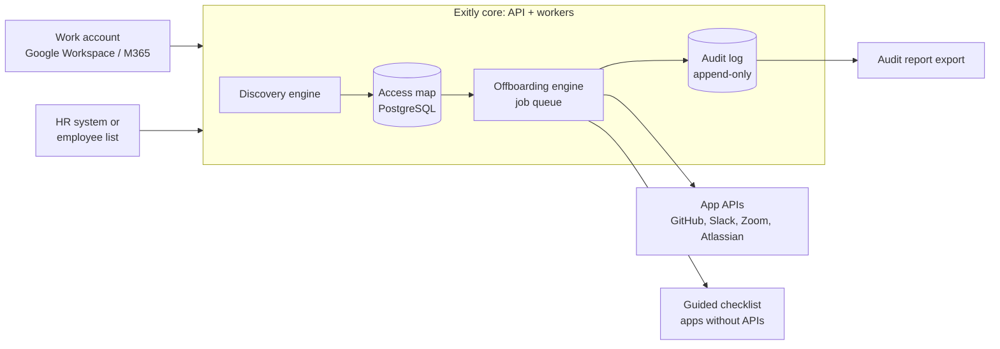

# Exitly

**Clean exits for every team.**
When someone leaves, Exitly finds every tool they can still open, closes what it can, and keeps proof that it was done.

> Built for **Build With Bharat 5.0** (National Level Hackathon)
> Team: `[Add team name]` · College: `[Add college name]` · Members: `[Add member names]`
> Demo: `[Add demo / video link]`

---

## The problem

People leave. Their logins quietly stay behind. Small companies (10 to 75 employees, no dedicated security team) use dozens of SaaS tools, and nobody owns the cleanup when an employee departs.

| Pain | What happens |
|---|---|
| **Security risk** | Leftover logins let former staff see chats, files, code and customer data they no longer need. |
| **Compliance gaps** | Reviews such as SOC 2 ask for proof that access was removed. Manual cleanup rarely leaves any. |
| **Wasted spend** | Seats for people who left keep renewing every month. |

Tool counts and cost figures in our pitch are working estimates, to be confirmed through founder interviews.

## The solution

A self-serve tool that does three things: **Discover → Revoke → Prove**.

1. **Connect**: link the company work account (Google Workspace first).
2. **Map**: see every person and every tool they can reach.
3. **Exit**: start a departure; Exitly closes what the app's API allows and lists the rest as a guided checklist.
4. **Prove**: export a record of who lost access to what, and when.

## Key features

| Feature | What it does | Status |
|---|---|---|
| Risk-ranked exits | Scores each departure by what the person could reach | ✅ Working in demo |
| Exit plan with approval gate | API removals plus manual checklist; admin/owner removals wait for approval | ✅ Working in demo (simulated) |
| Audit-ready proof | Hash-chained, append-only log with CSV export | ✅ Working in demo |
| Savings view | Shows what idle seats cost per person | ✅ Working in demo |
| Google Workspace connection | Real discovery and suspension via Admin SDK | 🛠 Planned (Phase 1) |
| Ghost-account finder | Weekly scan for logins that belong to nobody on the team | 🛠 Planned (Phase 2) |
| `/exit` chat command | Start cleanup from Slack or Teams | 🛠 Planned (Phase 2) |
| File handover | Pass documents and code to a manager before closing an account | 🛠 Planned |

**Honest status:** this repository contains a runnable **demo backend with sample data**. Revocations are **simulated**; no real vendor API is called yet. See [`docs/ROADMAP.md`](docs/ROADMAP.md).

## Architecture



Details in [`docs/ARCHITECTURE.md`](docs/ARCHITECTURE.md).

## Tech stack

| Layer | Choice |
|---|---|
| Frontend | Plain HTML/CSS/JS for the demo (React / Next.js planned) |
| Backend | Python, FastAPI |
| Database (planned) | PostgreSQL |
| Job queue (planned) | Redis + Celery |
| Integrations (planned) | Google Admin SDK, Microsoft Graph, GitHub REST, Slack SCIM |
| Security | OAuth least privilege, encrypted secrets, audit log |
| Hosting (planned) | Render or Fly.io first, AWS later |

The demo is a single FastAPI app that also serves a plain HTML/CSS/JS page (no build step), with in-memory sample data.

## Quick start (demo)

Requires Python 3.11+.

```bash
git clone https://github.com/<your-username>/EXITLYSAAS.git
cd EXITLYSAAS/backend
python -m venv .venv && source .venv/bin/activate   # Windows: .venv\Scripts\activate
pip install -r requirements.txt
uvicorn app.main:app --reload
```

Open **http://127.0.0.1:8000** for the demo UI (pick a person, plan the exit, run it, download the proof).
The interactive API docs are at **http://127.0.0.1:8000/docs**.

### Try the flow

```bash
# 1. See who is in the sample company
curl http://127.0.0.1:8000/people

# 2. Plan Sam's departure (returns risk score, steps, monthly savings, exit_id)
curl -X POST http://127.0.0.1:8000/exits/p1

# 3. Execute (simulated). Admin/owner removals are held for approval
curl -X POST "http://127.0.0.1:8000/exits/<exit_id>/execute"

# 4. Approve and run again on a fresh plan
curl -X POST "http://127.0.0.1:8000/exits/<exit_id>/execute?approve_sensitive=true"

# 5. Proof: verify the log and download the CSV
curl http://127.0.0.1:8000/audit
curl http://127.0.0.1:8000/audit/export.csv
```

### Run the tests

```bash
cd backend
pytest
```

## API overview

| Method | Path | Purpose |
|---|---|---|
| GET | `/health` | Service status |
| GET | `/people` | Sample employees |
| GET | `/people/{id}/access` | Apps a person can reach |
| POST | `/exits/{person_id}` | Build an exit plan with risk score |
| POST | `/exits/{exit_id}/execute` | Run the plan (simulated); `approve_sensitive=true` releases held steps |
| GET | `/audit` | Audit entries plus `chain_valid` check |
| GET | `/audit/export.csv` | Audit report export |
| GET | `/savings` | Seat cost freed by each exit |

## How it compares

| | Enterprise suites (e.g. Zluri, Torii) | Exitly |
|---|---|---|
| Customer | 500+ employees | 10 to 75 employees |
| Buying | Demos and contracts | Sign up online |
| Setup | Weeks | About ten minutes (goal) |
| Price | Custom quotes | Posted per-person price |
| Commitment | Annual | Month to month |

**Business model:** $3 to $8 per person per month (a 30-person team pays roughly $90 to $240 a month). Later: audit packs and a plan for IT consultants managing many small clients.

Our edge is the buying experience, not a brand-new problem. The main risk is larger vendors adding cheap plans, so speed and focus matter. See [`docs/VALIDATION.md`](docs/VALIDATION.md).

## Security principles

- Least-privilege OAuth scopes only
- Encrypted secrets, never committed (see `.env.example`)
- Destructive actions need admin approval
- Tamper-evident audit log

See [`SECURITY.md`](SECURITY.md).

## Roadmap

- **Phase 1, Prove it:** Google Workspace connection, exit checklist, activity log
- **Phase 2, Widen it:** Microsoft 365, GitHub, Slack, HR-system link, ghost-account alerts
- **Phase 3, Sell it:** spend discovery, audit packs, IT-consultant plan

Next 30 days: interview 10 to 15 founders and operations leads, ship the Google Workspace prototype, recruit three pilot teams.

## Repository structure

```
exitly/
├── README.md
├── LICENSE
├── SECURITY.md
├── CONTRIBUTING.md
├── .env.example
├── .gitignore
├── docs/
│   ├── ARCHITECTURE.md
│   ├── ROADMAP.md
│   └── VALIDATION.md
├── backend/
│   ├── requirements.txt
│   ├── app/        # FastAPI demo: models, risk scoring, planner, audit log
│   └── tests/
└── frontend/
    └── index.html  # simple demo UI (served by the backend)
```

## References

- [Slack SCIM API](https://docs.slack.dev/admins/scim-api)
- [Google Admin SDK (Directory API)](https://developers.google.com/admin-sdk)
- [Microsoft Graph documentation](https://learn.microsoft.com/graph)
- [GitHub REST API](https://docs.github.com/rest)
- Competitors: [Zluri](https://zluri.com), [Torii](https://toriihq.com)

App plan limits vary by vendor and will be re-checked against current docs during the build.

## Team

| Name | Role |
|---|---|
| `[Name]` | `[Role]` |

## License

MIT, see [LICENSE](LICENSE).
