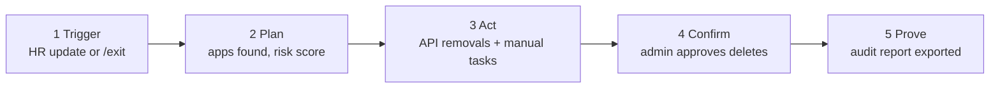

# Architecture

## Components

| Component | Responsibility |
|---|---|
| **Discovery engine** | Reads the work account (Google Workspace / Microsoft 365) and optional HR list to build a map of people → apps → roles |
| **Access map** | PostgreSQL store of who can reach what (demo: in-memory sample data) |
| **Offboarding engine** | Turns a departure into steps; API removals where the vendor allows, guided checklist where not; job queue for retries |
| **Audit log** | Append-only, hash-chained record of every action and outcome |
| **Outputs** | App APIs (GitHub, Slack, Zoom, Atlassian), guided checklist, audit export |

## Offboarding workflow

## Design decisions

- **Approval gate:** admin/owner-level removals are held until a human approves.
- **API-or-checklist:** some apps lock user controls behind costly plans, so every app is either `revoke_via_api` or `manual_checklist`. Nothing is silently skipped.
- **Tamper-evident log:** each entry stores the previous entry's SHA-256, so editing history breaks the chain (`GET /audit` reports `chain_valid`).
- **Isolated connectors (planned):** each vendor integration is separate and monitored, because vendor APIs change.

## Risk scoring (demo)

`score = Σ (app sensitivity weight × role multiplier)`, capped at 100.

| Sensitivity | Weight | Role | Multiplier |
|---|---|---|---|
| low | 5 | member | 1.0 |
| medium | 15 | admin | 1.5 |
| high | 30 | owner | 1.75 |

Levels: `<20` low, `20-39` medium, `40-69` high, `70+` critical. These weights are placeholders to be tuned with real interview data.

## What is real vs simulated today

| Real in this repo | Simulated |
|---|---|
| Risk scoring, plan building, approval gate, audit chain, CSV export | All vendor revocations, all discovery (sample data) |
